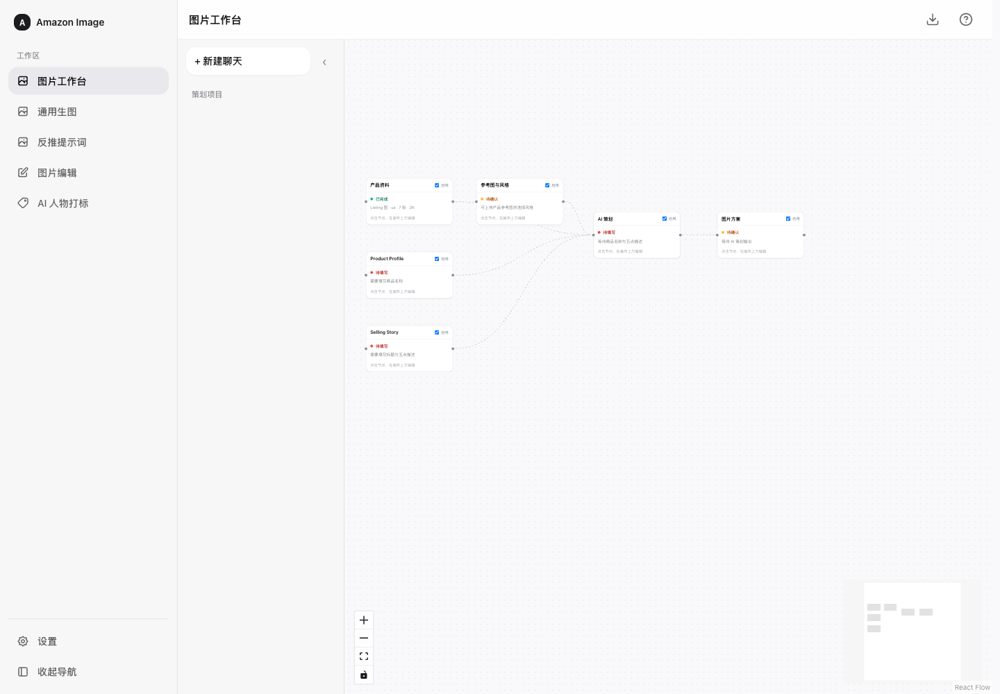
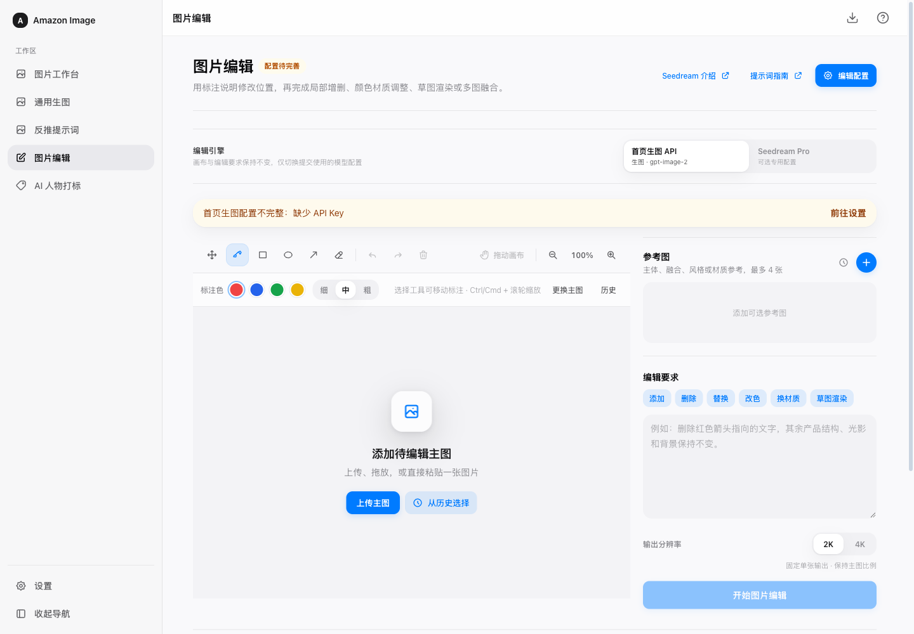
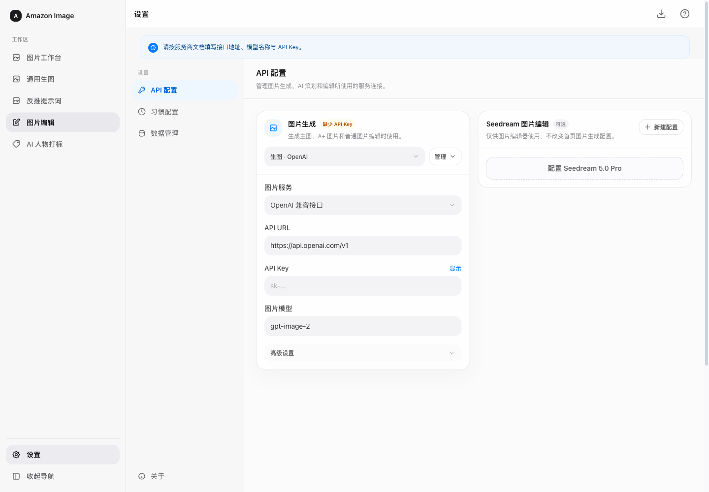

# 亚马逊图片工作台

Amazon Image Workbench · 产品图片策划、生成与编辑

[安装运行](#安装运行) · [界面预览](#界面预览) · [接口配置](#接口配置) · [Skill](#随附的-amazon-图片策划-skill) · [支持作者](#支持作者与部署协助)

亚马逊图片工作台是一个面向 Amazon Listing 的产品图片策划与生成工作台，基于 [Ali-Aria/amazon-image-studio](https://github.com/Ali-Aria/amazon-image-studio) 修改。

它适合把产品标题、五点描述、卖点文案和参考图整理成 Amazon 商品图片或 A+ Content 图片方案，并继续生成、编辑和管理图片。此版本聚焦图片制作工作流，采用 MIT 协议免费开源。

## API 中转站推荐

<a href="https://apikey.fun/register?aff=Q8QBWMYWFPCT"></a>

**APIKEY.FAN** 是面向开发者与团队的 AI 模型 API 中转服务，提供 Claude、ChatGPT、Gemini 等主流模型的统一接入。根据官网介绍，支持支付宝和微信支付，可按需求选择模型并查看调用价格，适合需要在工具中接入多种 AI 模型的用户。

[通过作者邀请链接了解并注册 →](https://apikey.fun/register?aff=Q8QBWMYWFPCT)

此处为作者推荐的推广位。具体模型、接口兼容性、价格与服务规则以中转站说明为准；本项目也支持其他兼容服务。

## 功能

| 工作区 | 用途 |
| --- | --- |
| 图片工作台 | 画布组织、Amazon 图片与 A+ 策划、参考图与风格管理、生成任务与历史记录 |
| 通用生图 | 按提示词与参考图生成图片，保留会话方便迭代 |
| 反推提示词 | 根据上传图片分析画面，整理可复用的提示词 |
| 图片编辑 | 配合模型执行局部修改、替换、改色和标注编辑 |
| AI 人物打标 | 在浏览器本地给图片、视频写入合成人物 XMP 标记，并下载处理结果 |

已移除独立的搜索词排序、ABA 搜索词采集、Listing 文案工作区、装箱计算器，以及相关后台接口和专用依赖。图片策划所需的商品标题、五点描述和 Amazon Listing 图片功能仍然保留。

## 界面预览

以下截图来自本开源版的全新浏览器会话，没有导入作者的产品资料、生成历史或 API Key。

### 图片工作台



### 图片编辑



### API 配置



## 安装运行

### 环境要求

- Windows、macOS 或 Linux。
- **Node.js 22 LTS（22.12 或更新版本）**，包含 npm；推荐安装当前受支持的 LTS 版本。
- 当前版本的 Chrome、Edge、Firefox 或 Safari。
- Git 用于克隆仓库；也可直接在 GitHub 点击 `Code → Download ZIP`，解压后运行。
- AI 策划、反推、生图和编辑需要你自己的模型接口与 API Key；本项目不附带 Key 或调用额度。

这是 React + TypeScript + Vite 前端应用，使用 Zustand、IndexedDB 与 Tailwind CSS；不需要 Python、MySQL，也不要求安装 AI 编程助手。

### 手动安装

```bash
git clone https://github.com/zkizz/amazon-image-workbench.git
cd amazon-image-workbench
npm ci
npm run dev
```

在浏览器打开终端输出的地址，通常为 `http://localhost:5173`。端口被占用时以终端显示为准。保持终端运行，按 `Ctrl+C` 停止。

### 双击启动

先安装 Node.js 并下载项目，然后：

- **Windows**：双击 `start-amazon-image.bat`；停止时使用 `stop-amazon-image.bat`。
- **macOS**：双击 `启动.command`。如无执行权限，先在项目目录运行 `chmod +x 启动.command`。
- **Linux**：按上面的手动命令运行。

启动脚本首次运行会安装依赖。安装为 PWA 后，本地服务仍需保持运行。

## 接口配置

打开左侧「设置」，填写自己的接口信息。API Key 通过界面输入，**不要写入源码或提交到 GitHub**。

| 配置 | 填写内容 |
| --- | --- |
| 生图连接 | 服务商 API URL、API Key、图片模型与对应接口类型 |
| AI 策划 | 支持文本/多模态的聊天或 Responses 模型，用于分析商品与整理图片方案 |
| 图片编辑 | 按编辑工作区支持的服务商填写独立编辑配置 |

- 支持 OpenAI 兼容接口，以及代码中适配的 OpenRouter、火山方舟、阿里云百炼、fal 等服务；具体能力取决于接口和模型。
- OpenAI 兼容 URL 示例：`https://api.openai.com/v1`。第三方中转请使用服务商提供的 **API 基地址**，不要填注册链接。
- 同一套 URL/Key 同时支持聊天和生图时，可使用「单连接」模式；否则分别配置生图和 AI 策划。
- 策划模型需要支持聊天接口；只有图片接口的服务不能用于 AI 策划。DeepSeek 官方策划连接会按纯文本处理，不读取参考图。
- 配置 `api.apikey.fan` 时，当前适配会走同源 `/api-proxy`。本地开发已带此代理；生产部署请使用下方 Docker 代理方案，或自行提供对应代理。

### 推荐流程

1. 在设置里保存并测试接口连接。
2. 输入产品标题、五点描述、已确认的材质、尺寸、数量，上传产品实拍或参考图。
3. 在工作台完成图片策划，选择主图、附图或 A+ 图位与视觉风格。
4. 检查方案后提交生成，按需到编辑工作区继续修改。
5. 下载成品，上架前核对产品结构、数量、文字与 Amazon 对应站点规则。

## 随附的 Amazon 图片策划 Skill

仓库包含 [`skills/amazon-image-generation-info/SKILL.md`](skills/amazon-image-generation-info/SKILL.md)，名称为 **amazon-image-generation-info（亚马逊图片生成信息）**。

它把「参考图 + 产品标题 + 五行 Item Highlights」整理成可直接用于图片生成或编辑工具的中英文资料：

- 产品信息、卖点故事、包装清单与已知尺寸换算。
- 主图、信息图、细节图和场景图的构图及中英文提示词。
- 禁用元素与负面提示词，限制错误数量、结构、材质和未经证实的声明。
- 按当前产品定制的六色色板，含 Hex、RGB、用途，以及字体、光影、材质和信息密度建议。
- 局部编辑时明确保留内容与修改边界；资料不确定时先核对，避免将参考图中的品牌、尺寸和性能误当成本品事实。

**它负责策划资料和提示词，不直接生成图片，也不会自动接入网页。** 网页本身可独立使用。

### 使用方法

将整个 `skills/amazon-image-generation-info` 文件夹复制到所用 AI 助手支持的技能目录；个人 Codex 技能目录通常为 `~/.codex/skills/`，Windows 为 `%USERPROFILE%\.codex\skills\`。重新打开助手后调用该技能，并提供图片、标题和五行卖点。

也可直接阅读 `SKILL.md`，将规则作为提示词使用。示例：

```text
请使用 amazon-image-generation-info。
根据我上传的产品实拍图、标题和五行卖点，整理 Amazon 图片生成资料。
输出中英文提示词、禁用元素和六色色板，未知产品事实先向我确认。
```

整理完成后，把相应信息填入工作台的商品信息、卖点、场景/构图和禁用元素字段。

## 构建与部署

### 生产构建

```bash
npm run build
npm run preview
```

构建结果在 `dist/`。`preview` 仅用于本地检查生产构建，不包含 Vite 开发代理。静态部署时，接口必须允许浏览器 CORS 访问，或由部署方提供代理；HTTPS 页面应使用 HTTPS API。

### Docker / Nginx

```bash
docker build -f deploy/Dockerfile -t amazon-image-workbench .
docker run --rm -p 8080:80 amazon-image-workbench
```

需要同源 API 代理时：

```bash
docker run --rm -p 8080:80 \
  -e ENABLE_API_PROXY=true \
  -e API_PROXY_URL=https://api.openai.com/v1 \
  -e DEFAULT_API_URL=https://api.openai.com/v1 \
  amazon-image-workbench
```

将两个 URL 替换为实际服务地址；使用 `api.apikey.fan` 时填写服务商确认的完整基地址。打开 `http://localhost:8080`，在网页设置中填写 Key。Docker 内置了限定域名的图片下载代理，处理部分火山/百炼图片 URL 的跨域下载。

### Vercel / Cloudflare Pages

连接自己的 GitHub 仓库，选择 Vite：

```text
安装命令：npm ci
构建命令：npm run build
输出目录：dist
Node.js：22
```

Cloudflare Workers 静态资源也可运行 `npm run deploy:cf`，首次需完成自己的 Cloudflare 登录。

### GitHub Pages

仓库附带 `.github/workflows/deploy.yml`，手动触发部署，避免刚开源就部署失败：

1. 打开仓库 `Settings → Pages`，Source 选择 `GitHub Actions`。
2. 在 `Actions → Deploy to GitHub Pages → Run workflow` 执行。
3. 访问工作流给出的页面地址。

Vite 使用相对路径 `base: './'`，支持仓库子目录。Pages 只有静态托管，没有 `/api-proxy`；需要代理的服务请选择 Docker 或自行配置后端。

### 可选环境变量

参考 [`.env.example`](.env.example)。前端 `VITE_*` 变量会进入公开构建产物，只适合放 API 基地址与功能开关，不能存放 API Key。

## 数据与隐私

开源包只包含系统代码、内置通用素材和知识文档、Skill，以及作者明确公开的广告图、收款码与微信二维码。未包含原项目的业务表格、ABA 数据库、附件、日志、浏览器历史、私有配置或 Git 历史。

配置、图片任务与会话保存在当前浏览器的本地存储/IndexedDB；本版本使用独立的数据命名空间，不会自动导入原版工作台记录。切换浏览器或清除网站数据会影响本地资料，重要图片请及时下载。

图片生成、策划与反推会将相应输入发送到你配置的模型服务商；AI 人物打标在本地处理。导出的备份、配置链接可能包含你选择导出的信息，分享前请检查。请勿把个人备份、产品素材或密钥上传到仓库。

## 常见问题

- **页面打不开**：确认已执行 `npm ci`，并保持 `npm run dev` 运行；使用终端实际输出的端口。
- **策划失败**：检查聊天/Responses 接口、文本模型和额度；生图接口不能代替策划接口。
- **图片生成失败**：检查模型名、接口类型、尺寸、参考图数量和服务商限制。
- **部署后本地能用、线上不能用**：检查 CORS、HTTPS，以及是否缺少 `/api-proxy`；静态托管不会自动获得开发服务器代理。
- **无法下载部分远程图片**：检查远程图片是否允许跨域，或使用带图片代理的 Docker 部署。

开发检查：

```bash
npm test
npm run build
```

## 许可与致谢

本项目以 [MIT License](LICENSE) 发布，允许使用、修改、分发及商业使用，须保留版权与许可声明。软件按现状提供。

- 直接上游：[Ali-Aria/amazon-image-studio](https://github.com/Ali-Aria/amazon-image-studio)。
- 上游基础项目：[CookSleep/gpt_image_playground](https://github.com/CookSleep/gpt_image_playground)。
- 本版本维护：[zkizz](https://github.com/zkizz)。

上游作者的版权声明保留在 `LICENSE` 中；第三方依赖遵循各自许可证。第三方部署、定制或技术支持费用是其服务费用，不代表上游作者的官方服务。本项目不包含模型服务本身、免费额度或任何上游作者的服务承诺。

## 支持作者与部署协助

作者制作不易，持续维护主要靠业余时间，为爱发电。如果这个工具对你有帮助，欢迎点个 Star、反馈问题，或自愿赞赏支持后续维护。

需要部署帮助或交流使用问题，可加微信咨询部署协助。**添加时请备注「GitHub + 项目名」**，并简要说明遇到的问题，方便识别与回复。部署协助的时间和具体方式请先沟通。

<table>
<tr><th>自愿赞赏 · 微信收款码</th><th>联系作者 · 微信二维码</th></tr>
<tr>
<td align="center"></td>
<td align="center"></td>
</tr>
</table>
